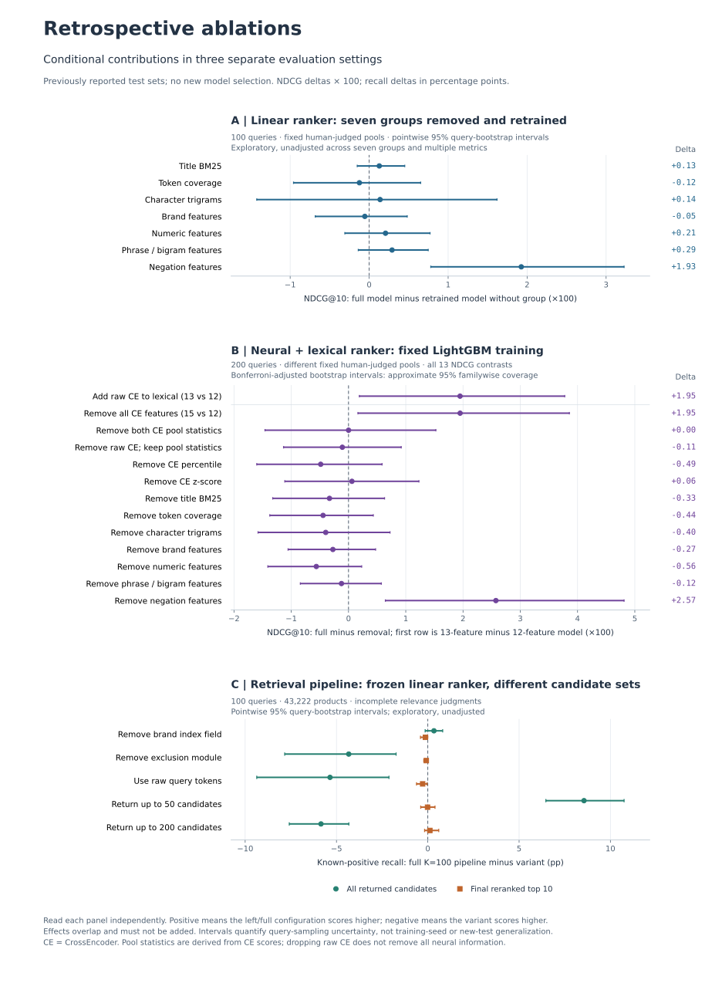

# 每个模块带来了什么：真实数据消融

本次是已报告测试集上的**回顾性诊断**，用于解释已有结果。完整模型先重训复现，随后逐组删除并重新训练；另列冻结模型输入置零的敏感性实验。所有正面、负面和区间跨零结果均保留，没有根据这些结果选择新模型或更换默认配置。



图中A/B为NDCG差值×100，C为召回率差值（百分点）。各面板的数据、区间校正和比较方向分别标注，不能把效果相加。

## 数据与比较范围

| 实验 | 商品数 | train / val / test查询 | 测试判断对 |
|---|---|---|---|
| 公共CPU特征消融 | 43222 | 1000 / 100 / 100 | 3741 |
| 历史神经精排 | 82427 | 500 / 200 / 200 | 7646 |
| 公共检索消融 | 43222 | 沿用原模型 / 100 test | 同公共数据 |

两套数据的绝对分数不能直接比较。候选内NDCG使用完全相同且全部已标注的候选；全库实验仅统计已知E/S正例召回，未标注商品不当作负例。公共目录是有限的已标商品集合，不是完整Amazon库。

所有去组效果依赖其余组件、特征之间的替代关系和训练配方，**不能相加为各模块贡献百分比**。固定配方消融也不等于为每个变体寻找了最优参数。

## 1. 公共词法排序：七组特征分别重训

完整12维模型NDCG@10为 **0.749428**。所有变体保持相同的1000个训练查询、30轮、学习率、初始化和采样种子。下表Δ=完整−去组，正数表示移除后变差。冻结敏感性是不重训直接置零，与去组重训回答不同问题。

| 移除组 | 去组重训NDCG | 重训Δ | 95%配对区间 | 冻结敏感性Δ | 候选间值变化的查询数 |
|---|---|---|---|---|---|
| 标题 BM25 | 0.748146 | +0.001282 | [-0.0015, +0.0045] | +0.000349 | 96 |
| token覆盖 | 0.750663 | -0.001235 | [-0.0096, +0.0065] | +0.002551 | 94 |
| 字符trigram | 0.748043 | +0.001385 | [-0.0142, +0.0162] | +0.001568 | 100 |
| 品牌匹配/冲突 | 0.749976 | -0.000548 | [-0.0068, +0.0048] | -0.000358 | 21 |
| 数字匹配/冲突 | 0.747357 | +0.002071 | [-0.0031, +0.0077] | +0.003809 | 16 |
| bigram/短语 | 0.746529 | +0.002899 | [-0.0014, +0.0075] | +0.003444 | 81 |
| 否定约束特征 | 0.730169 | +0.019259 | [+0.0078, +0.0323] | +0.019542 | 26 |

这些95%区间未做多重比较校正，仅用于探索；跨零表示证据不足。描述字段全部为空，无法据此判断真实描述信息是否有价值。短语组是排序中的bigram/匹配，并非查询规划器的引号语法。删除否定特征列仍保留共享查询解析和检索过滤。

同一个真实召回池上的重训结果如下。率的变化用**百分点**表示，区别于NDCG绝对差值。

| 移除组 | 重训后已知正例Recall@10 | 完整−移除（百分点） | 95%区间（百分点） |
|---|---|---|---|
| 标题 BM25 | 19.10% | -0.0264 | [-0.1657, +0.1042] |
| token覆盖 | 18.69% | +0.3814 | [-0.2101, +0.9256] |
| 字符trigram | 18.39% | +0.6787 | [-0.5422, +1.9062] |
| 品牌匹配/冲突 | 19.02% | +0.0532 | [-0.1658, +0.3142] |
| 数字匹配/冲突 | 19.58% | -0.5110 | [-0.9551, -0.1650] |
| bigram/短语 | 19.42% | -0.3450 | [-0.6801, -0.0393] |
| 否定约束特征 | 18.70% | +0.3729 | [-0.0217, +0.8524] |

所有排序条件共享每个查询的一次召回结果，因此Recall@100保持不变。人工候选池中的排序收益不能替代真实全库收益。[完整特征汇总](../reports/ablation-features-v1/report.json)。

## 2. 神经精排：CE语义、词法约束与池内统计

| 方法 | NDCG@10 | Exact@1 |
|---|---|---|
| BM25 | 0.710818 | 68.50% |
| 单独CE | 0.739240 | 72.50% |
| 词法12维LambdaMART | 0.755267 | 76.50% |
| 词法12维+原始CE | 0.774748 | 78.00% |
| 完整15维：再加池内统计 | 0.774758 | 80.50% |

第一行对比是加入CE；其余都是完整15维−去组重训。保持同一7叶、200轮LambdaMART配方，不重新调参。NDCG区间对13个预设比较作Bonferroni校正，单比较置信度99.6154%，bootstrap覆盖率为近似。

| 比较 / 移除组 | NDCGΔ | 多重比较校正区间 | 本次证据 |
|---|---|---|---|
| 词法12维 → 加原始CE分数 | +0.019480 | [+0.0019, +0.0378] | 正向区间未跨零 |
| 标题BM25 | -0.003321 | [-0.0132, +0.0063] | 未确认独立收益 |
| token覆盖 | -0.004445 | [-0.0137, +0.0043] | 未确认独立收益 |
| 字符trigram | -0.003977 | [-0.0158, +0.0073] | 未确认独立收益 |
| 品牌 | -0.002731 | [-0.0106, +0.0047] | 未确认独立收益 |
| 数字 | -0.005621 | [-0.0141, +0.0023] | 未确认独立收益 |
| bigram/短语 | -0.001228 | [-0.0084, +0.0057] | 未确认独立收益 |
| 否定约束特征 | +0.025739 | [+0.0064, +0.0481] | 正向区间未跨零 |
| 全部CE信息 | +0.019491 | [+0.0016, +0.0386] | 正向区间未跨零 |
| CE池内统计合计 | +0.000010 | [-0.0146, +0.0153] | 未确认独立收益 |
| 原始CE分数（仍保留派生统计） | -0.001078 | [-0.0113, +0.0092] | 未确认独立收益 |
| CE池内百分位 | -0.004857 | [-0.0160, +0.0059] | 未确认独立收益 |
| CE池内z-score | +0.000597 | [-0.0111, +0.0123] | 未确认独立收益 |

加入原始CE的差值为+0.019480，池内统计合计为+0.000010，完整模型相对去否定组为+0.025739；强弱结论按上表校正区间判断。不能因某个去组模型点估计较高就替换默认模型。

否定组在53/200个查询中有候选间变化。去组重训可能改变其他查询的排序，整体差值不是这些活跃查询的直接因果贡献。去原始CE分数仍保留两项CE派生统计，只有去除全部三列才是真正的无CE对照。

完整模型val/test最大预测误差分别为0/0，通过历史模型复现。实验复用经过指纹验证的历史特征缓存，重训耗时不包含重新执行CE推理。[全部神经结果](../reports/ablation-neural-v1/report.md)。

## 3. 全库检索：候选覆盖与最终Top10分开

所有配置沿用同一冻结排序器。候选池召回使用全部返回条目；Recall@100最多使用前100条，K=50时只有50条。移除品牌索引会重建字段TF/DF和长度统计，不只是把一个权重置零；重排仍使用原始品牌信息。

| 配置 | 平均候选数 | 候选池召回 | 词法Recall@10 | 重排Recall@10 | 重排Recall@100 |
|---|---|---|---|---|---|
| 完整基线 K=100 | 89.55 | 57.25% | 19.35% | 19.07% | 57.25% |
| 去品牌索引 K=100 | 89.48 | 56.91% | 19.31% | 19.20% | 56.91% |
| 去硬排除过滤 K=100 | 90.19 | 61.58% | 20.10% | 19.15% | 61.58% |
| 原始token K=100 | 91.85 | 62.60% | 20.70% | 19.35% | 62.60% |
| 完整流程 K=50 | 46.82 | 48.69% | 19.35% | 19.08% | 48.69% |
| 完整流程 K=200 | 168.55 | 63.10% | 19.35% | 18.96% | 56.47% |

下面Δ=完整K=100−变体，单位为百分点。区间为未校正的探索性95%区间。

| 对照变体 | 候选池召回Δ [CI] | 最终Recall@10 Δ [CI] |
|---|---|---|
| 去品牌索引 K=100 | +0.3371 [-0.1446, +0.8156] | -0.1313 [-0.4000, +0.0000] |
| 去硬排除过滤 K=100 | -4.3293 [-7.8354, -1.7348] | -0.0819 [-0.2193, +0.0000] |
| 原始token K=100 | -5.3536 [-9.3653, -2.1251] | -0.2812 [-0.6162, -0.0417] |
| 完整流程 K=50 | +8.5536 [+6.4653, +10.7488] | -0.0134 [-0.3869, +0.3946] |
| 完整流程 K=200 | -5.8480 [-7.5851, -4.3222] | +0.1137 [-0.1744, +0.6000] |

在预先定义的28个触发排除规则的查询中，开启−关闭硬过滤的候选召回差值为-15.4616个百分点，区间[-25.6563, -6.3580]。硬规则可能误解含否定词的商品名称，这是待逐查询核验的机制解释；本次直接证据是已知正例召回的变化。检索硬过滤与排序器学习的软约束必须分开。

候选K=100→200，候选召回57.25%→63.10%，最终Recall@10为19.07%→18.96%。多召回正例不自动转化为Top10收益。原始token模式同时改变停用词、否定和减号处理，不能归功于单条规则。

耗时仅描述当前机器：并行任务负载与OS缓存未受控；检索计时包含SQL和过滤，不含查询规划。不能据此声称加速。[检索汇总](../reports/ablation-retrieval-v1/report.json)。

## 复现与证据

公共实验先按README准备官方数据并完成基准，再运行[特征协议](FEATURE_ABLATION_PROTOCOL.md)和[检索协议](RETRIEVAL_ABLATION_PROTOCOL.md)。无需GPU，输入/源码/模型指纹变化会拒绝评测，重跑必须用新输出目录。

神经实验按[神经协议](NEURAL_ABLATION_PROTOCOL.md)运行。历史子集、模型权重与缓存不随源码发布，精确复现需自行取得匹配哈希的资源；仅克隆代码不能一键复现历史神经数字。不同输入应另建实验。

表格可以从公开汇总重新生成：

```bash
python scripts/summarize_ablations.py
```

重画上图另需Matplotlib（不影响标准库实验入口）：

```bash
python -m pip install matplotlib
python scripts/plot_ablations.py
```

| 报告 | 报告SHA256 | 协议SHA256 |
|---|---|---|
| features | `1dc9ed0fd9e33fc80b8eb400d0cdfde64da47b942bf08c29c74683e96b264dbf` | `a1bb4ef42f579a95fa8e5aac5317ce40439c20199115dd4d20b64d55de630d25` |
| neural | `ba47bbb3e9eb41015d89a3e9591dff80b6037d840f1994ee0e292147b80ae842` | `3154cc241d18a2b521bb9bbb80ac5425590afbc07c92da656a266cf42b792911` |
| retrieval | `97cd5e3a15c696539016bcd4da490f2972bd21179852c030224d7e28ded7f859` | `6acd23d1254abb693221b89a3e9ff2b212a0dec8f2333a58c1afd07acb7c3f7e` |

[本轮验证记录](../reports/ablation-summary-v1/verification.json)包括测试与中断恢复信息。所有bootstrap只衡量查询抽样不确定性，不包含多训练种子、训练集变化、上游预训练重叠或线上用户变化。

## 能说明的能力与下一步

本次能展示可复现的电商学习排序、CE语义融合、查询约束取舍、检索与重排误差分离，以及保留负面结果的实验能力。多模态、个性化、生成式检索和ANN/mmap未进入这条共同消融链，不能归入这里的NDCG提升。没有千亿规模、线上转化收益或顶会成果证据。

下一步优先在新的训练/验证划分上研究软约束或实体感知的否定处理，并用检索候选训练排序器，再用新的未见测试查询确认收益。当前不依据已见测试集挑赢家。
